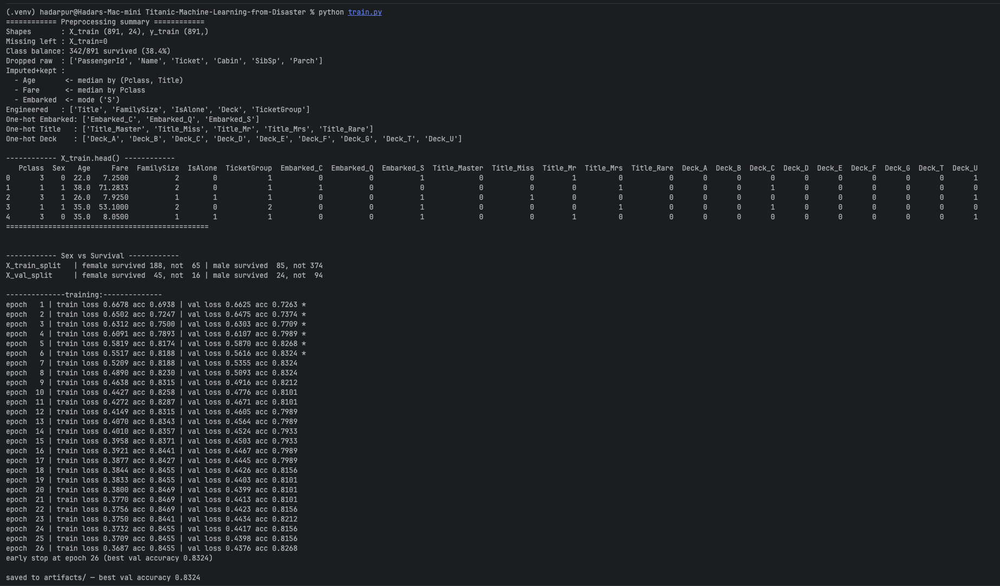
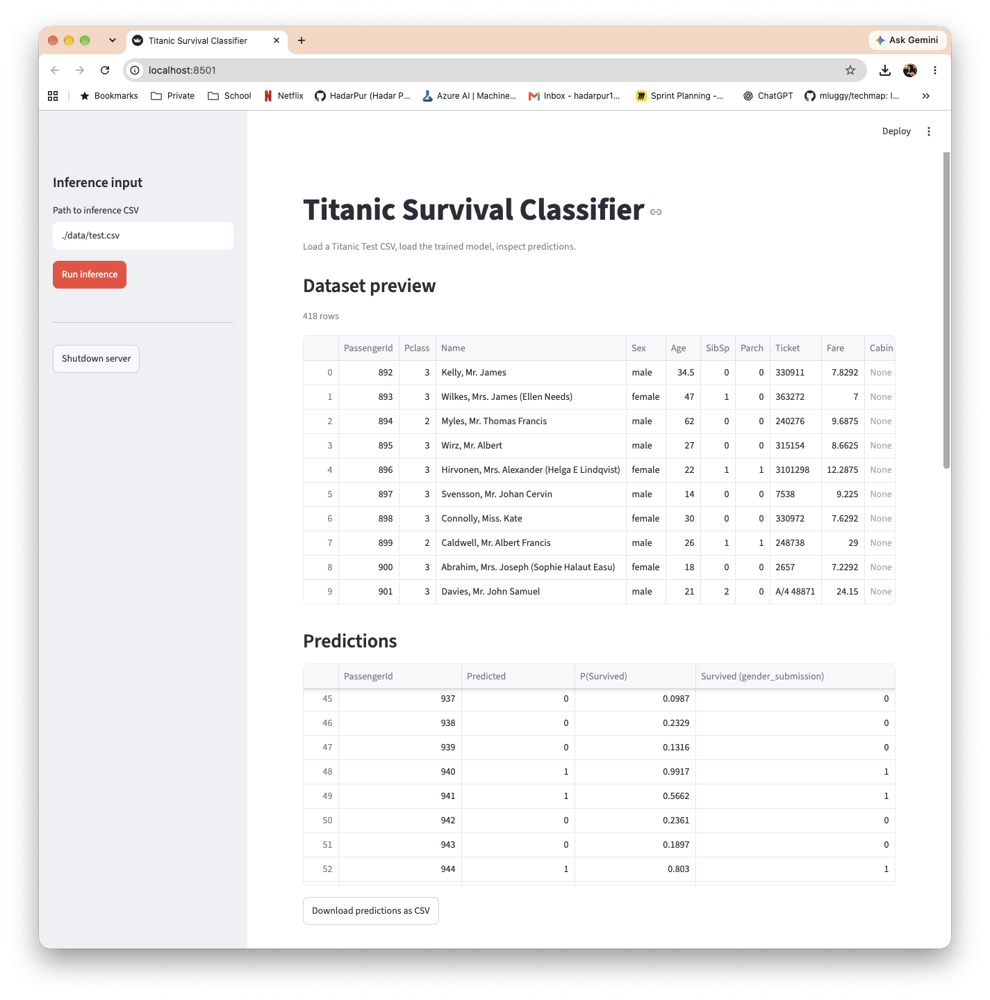
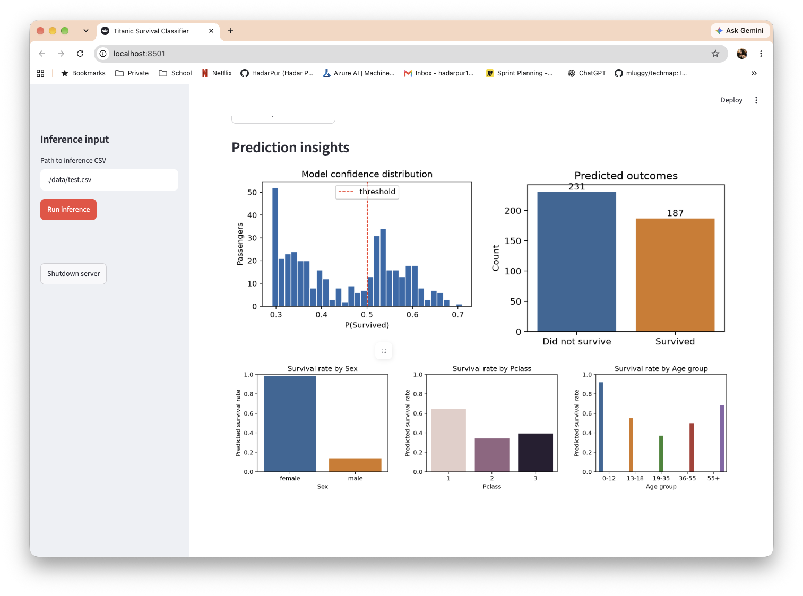

# Titanic - Machine Learning from Disaster

A PyTorch solution to the classic [Kaggle Titanic competition](https://www.kaggle.com/c/titanic). A small MLP classifier predicts whether a passenger survived based on features such as class, sex, age, family size, title, deck, and ticket group.

The project ships two apps:

1. **`train.py`** — end-to-end training script that preprocesses the data, trains the model, and persists all artifacts needed for inference.
2. **`ds_app.py`** — Streamlit UI that loads the trained artifacts, runs predictions on a user-supplied CSV, and visualizes the results.

---

## Project structure

| File | Purpose |
|---|---|
| `fetch_data.py` | Downloads the competition dataset from Kaggle into `data/` |
| `titanic_eda.ipynb` | Exploratory data analysis of the training set |
| `preprocess.py` | Missing-value imputation, feature engineering, encoding |
| `model.py` | `TitanicMLP` — a 2-hidden-layer PyTorch classifier |
| `config.py` | Hyperparameters, seed, split fraction, and artifact paths |
| `artifacts.py` | Save/load helpers for the trained artifact bundle |
| `evaluate.py` | Loss + accuracy evaluation over a `DataLoader` |
| `utils.py` | Small reporting helpers used by `train.py` |
| `train.py` | **App 1** — trains the model and writes artifacts into `artifacts/` |
| `ds_app.py` | **App 2** — Streamlit inference app |

After training, `artifacts/` contains:

```
artifacts/
├── model.pt       # PyTorch state_dict (best val-accuracy checkpoint)
├── scaler.pt      # Per-column mean/std used to standardize inputs
├── columns.json   # Feature order expected by the model
└── imputers.pkl   # Fitted imputation stats (Age / Fare / Embarked)
```

All four files are required at inference time: the scaler undoes training-time standardization, `columns.json` reorders new rows to match the training schema, and `imputers.pkl` lets inference fill missing values without re-reading `train.csv`.

---

## Setup

Clone the repo and create a virtual environment:

```bash
git clone https://github.com/HadarPur/Titanic-Machine-Learning-from-Disaster.git
cd Titanic-Machine-Learning-from-Disaster

python3 -m venv .venv
source .venv/bin/activate     # Windows: .venv\Scripts\activate
```

Install dependencies:

```bash
pip install -r requirements.txt
```

Core dependencies: `torch`, `pandas`, `numpy`, `scikit-learn`, `streamlit`, `matplotlib`, `seaborn`, `kagglehub`, `notebook`.

### Download the dataset

`fetch_data.py` uses the Kaggle API. Place a Kaggle API token at `~/.kaggle/kaggle.json` and accept the competition rules on [kaggle.com](https://www.kaggle.com/c/titanic/rules), then run:

```bash
python fetch_data.py
```

This writes `train.csv`, `test.csv`, and `gender_submission.csv` into `data/`.

### (Optional) Explore the data

```bash
jupyter notebook titanic_eda.ipynb
```

---

## Running the apps

### App 1 — Training (`train.py`)

Trains the MLP and saves artifacts to `artifacts/`:

```bash
python train.py
```

What it prints:

1. **Preprocessing summary** — shapes, missing-value check, class balance, engineered features, one-hot groups, head preview.
2. **Sex-vs-survival breakdown** on the train/val split — sanity check that the stratified split preserved the sex distribution.
3. **Epoch log** — training/validation loss and accuracy per epoch, with a `*` marking a new best. Early stopping fires after `EARLY_STOP_PATIENCE` (20) epochs with no improvement.
4. **Final artifact location** and best validation accuracy.

Hyperparameters live in `config.py` (`SEED`, `VAL_FRACTION`, `BATCH_SIZE`, `LEARNING_RATE`, `WEIGHT_DECAY`, `MAX_EPOCHS`, `EARLY_STOP_PATIENCE`).

### App 2 — Streamlit inference UI (`ds_app.py`)

Launch the UI:

```bash
streamlit run ds_app.py
```

Then in the sidebar:

1. Enter a path to a Titanic-shaped CSV (default: `./data/test.csv`).
2. Click **Run inference**.

The app displays:

* A preview of the uploaded CSV.
* A predictions table (`PassengerId`, `Predicted`, `P(Survived)`), with a CSV download button.
* A probability-distribution histogram and a predicted-outcome bar chart.
* Predicted survival rate broken down by `Sex`, `Pclass`, and age group.

A **Shutdown server** button in the sidebar stops the Streamlit process cleanly.

---

## Example usage

Screenshots live in `docs/screenshots/` (create the folder and drop PNGs in with the names below).

**Training pipeline** — console output from `python train.py`:



**Streamlit app — predictions table and download**:



**Streamlit app — prediction insights (distribution, outcome counts, rate by Sex / Pclass / Age)**:



End-to-end:

```bash
# One-time
python fetch_data.py
python train.py

# Interactive inference
streamlit run ds_app.py
```

---

## Architecture and design choices

### Pipeline overview

```
data/train.csv ──► preprocess ──► train/val split ──► normalize ──► TitanicMLP ──► artifacts/
                                                                         │
data/test.csv ───► preprocess_inference ──► normalize ────────────────► predict (ds_app.py)
```

### Preprocessing (`preprocess.py`)

* **Feature engineering over raw columns.** `Name`, `Ticket`, and `Cabin` carry strong signal but need extraction before a model can use them:
  * `Title` — Mr / Mrs / Miss / Master / Rare (collapsed from the long tail; French/old variants folded in).
  * `FamilySize` = `SibSp + Parch + 1`, with `IsAlone` as a binary indicator.
  * `Deck` — first letter of `Cabin`, `U` when missing.
  * `TicketGroup` — number of passengers sharing the same ticket number.
* **Imputation without leakage.** Medians (Age by Pclass+Title, Fare by Pclass) and the Embarked mode are fit on the training set only, saved as `imputers.pkl`, and reused at inference time. Age is grouped by `Title` rather than `Sex` so that boys with the `Master` title aren't filled with the adult-male median.
* **Encoding.** `Sex` is binary (female=1, male=0); `Embarked` / `Title` / `Deck` are one-hot; `Pclass` is left as an ordinal 1/2/3 since the ordering is meaningful.
* **Column alignment.** `preprocess_inference` reindexes the output to the training-time column schema, so one-hot categories that only appear in inference (or are missing from it) don't produce mismatched columns.

### Model (`model.py`)

A small Multi-Layer Perceptron:

```
Linear(input → 32) → ReLU → Dropout(0.3)
Linear(32    → 16) → ReLU → Dropout(0.3)
Linear(16    → 1)                              # raw logit
```

* **Why an MLP, not a tree model?** Fine either way for this problem, but the goal here was to show a clean PyTorch training loop. For tabular data with no spatial/sequential structure, a shallow MLP is the right default.
* **Why so narrow (32 → 16)?** ~700 training rows can't support more capacity without overfitting.
* **Dropout 0.3** — relatively aggressive, justified by the small dataset.
* **Final layer is a raw logit, not a probability.** Training uses `BCEWithLogitsLoss` (numerically stable sigmoid+BCE); inference applies `torch.sigmoid` to recover `P(Survived)`.

### Training (`train.py`)

* **Stratified 70/30 split** on `Survived` so the ~38% positive rate is preserved in both train and validation. A larger (30%) holdout trades ~90 training rows for a less noisy val-accuracy signal.
* **Train-only normalization.** Mean/std are computed on the training split and then applied to val and inference. This is what keeps the pipeline leak-free.
* **Zero-std guard.** Constant columns (a one-hot category that happens to be single-valued in the training split) are divided by 1 instead of 0.
* **Early stopping on best val accuracy.** We snapshot the best weights (not the final epoch's) and ship those — late-training overfit doesn't degrade what gets saved.
* **Deterministic.** `SEED` seeds NumPy, PyTorch, and `train_test_split`.

### Inference app (`ds_app.py`)

* **No retraining ever happens in the app.** It loads the frozen artifacts and runs `preprocess_inference` with the saved imputers — the exact same transformations the model was trained on.
* **Cached model load.** `@st.cache_resource` keeps the model in memory between reruns of the script.
* **Threshold at 0.5** on the sigmoid output; the histogram shows the full distribution so this choice is visible.
